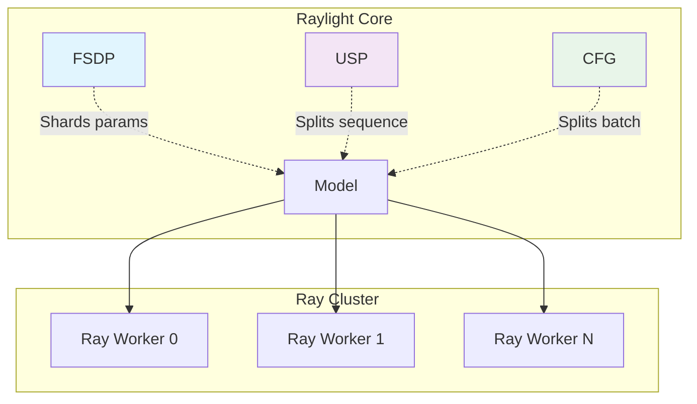
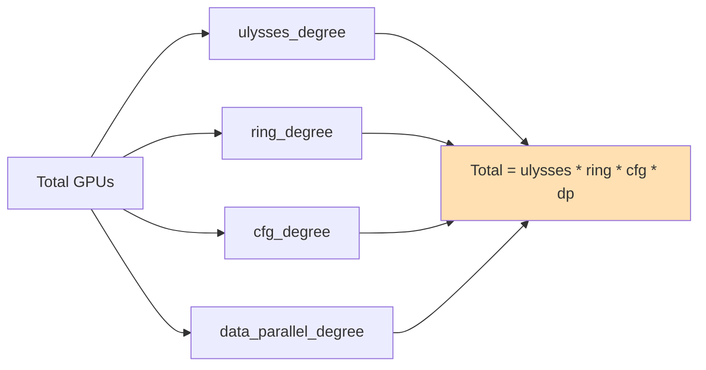
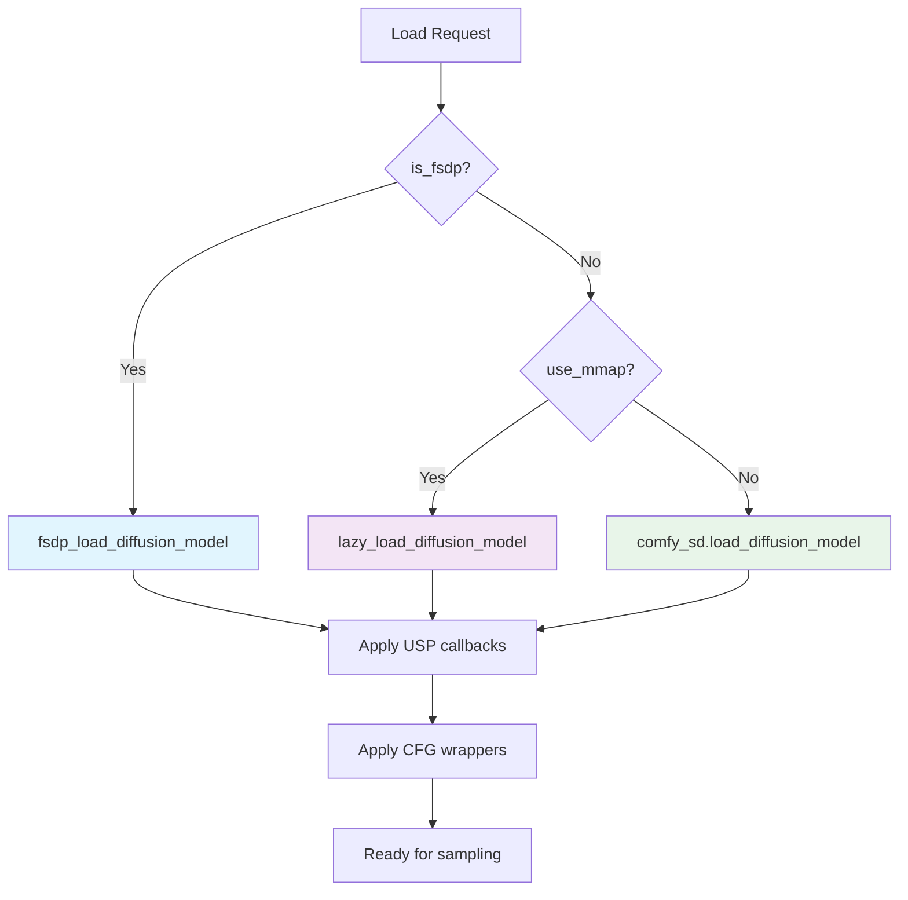

# Raylight Core Architecture

## Overview

Raylight is a distributed inference framework for ComfyUI that enables multi-GPU parallelism through complementary techniques: **FSDP**, **USP**, and **CFG Parallelism**

## Architecture Diagram



**Note**: PipeFusion code exists in the WAN implementation but is not used in Raylight.

## Quick Start

### Basic Configuration

```python
parallel_dict = {
    # FSDP (optional)
    "is_fsdp": False,
    "fsdp_cpu_offload": False,

    # USP/CFG (optional)
    "is_xdit": True,
    "ulysses_degree": 4,
    "ring_degree": 1,
    "cfg_degree": 2,

    # PipeFusion (optional, currently soft disabled)
    "pipefusion_enabled": False,

    # Other
    "use_mmap": True,
}
```

### GPU Requirements



**Example**: WAN21 with USP=4, CFG=2 on 8 GPUs
```
Total GPUs = 4 × 1 × 2 × 1 = 8 GPUs
```

## File Structure

```
custom_nodes/raylight/
├── docs/
│   ├── 1-intro.md              # This file
│   ├── 2-fsdp.md               # FSDP documentation
│   ├── 3-usp.md                # USP documentation
│   ├── 4-cfg.md                # CFG parallelism
│   └── 5-expansion.md          # Expansion modules
├── src/raylight/
│   ├── comfy_dist/
│   │   ├── sd.py               # Model loading (FSDP, GGUF, lazy)
│   │   ├── fsdp_utils.py       # FSDP utilities
│   │   └── lora.py             # Distributed LoRA
│   ├── distributed_modules/
│   │   ├── usp.py              # USP registry
│   │   ├── cfg.py              # CFG registry
│   │   └── attention.py        # xfuser attention factory
│   ├── distributed_worker/
│   │   └── ray_worker.py       # Ray worker implementation
│   └── diffusion_models/
│       ├── utils.py            # Padding utilities
│       ├── flux/               # Flux model parallelism
│       ├── wan/                # WAN model parallelism
│       ├── lightricks/         # LTXV/LTXAV parallelism
│       └── ...                 # Other models
└── expansion/
    ├── comfyui_gguf/           # GGUF model support
    └── comfyui_lazytensors/    # Lazy tensor loading
```

## Documentation Files

1. **[1-intro.md](1-intro.md)** - Overview and quick start (this file)
2. **[2-fsdp.md](2-fsdp.md)** - FSDP documentation
3. **[3-usp.md](3-usp.md)** - USP documentation
4. **[4-cfg.md](4-cfg.md)** - CFG parallelism
5. **[5-expansion.md](5-expansion.md)** - Expansion modules

## Key Concepts

### Registry Pattern

Raylight uses registry patterns for USP and CFG to support multiple models:

```python
# USP registry
@USPInjectRegistry.register(model_base.Flux)
def _inject_flux(model_patcher, base_model, *args):
    # Inject USP for Flux model
    ...

# CFG registry
@CFGParallelInjectRegistry.register(model_base.Flux)
def _inject_flux():
    # Return CFG wrapper for Flux
    return cfg_parallel_forward_wrapper
```

### Model Loading Flow



### Ray Patch Nodes and RAY_ACTORS

**Location**: `comfy_extra_dist/ray_patch_decorator.py`

Each worker holds one model, and a Ray patch node (`@ray_patch`: ModelSamplingSD3, RescaleCFG, CFG Override, ...)
replaces it with a patched clone. So that a `RAY_ACTORS` value behaves like a ComfyUI `MODEL`, it names the model its
node produced:

- loaders and patch nodes call `save_model_state`: the workers keep their current model under a new token, and the
  node returns `ray_actors` with that token under `model_state`;
- patch nodes and samplers call `use_model_state` first, which puts the workers back on the model their input names.

A sampler therefore runs with the patches of its own chain, also when ComfyUI reuses cached patch nodes on a re-run or
runs another branch's patches in between - for example per-stage settings like the TRELLIS.2 template's.

A worker drops its saved models when it loads another one. So the value also carries how to build its model again
(`model_recipe`): the loader call, then each patch node's call (`save_model_state(..., replay=...)`). When the model a
value names is gone, `use_model_state` reruns those calls. This is what keeps two-model workflows right on a re-run:
the Wan 2.2 template loads the high noise model, samples, then loads the low noise model into the same workers, and on
the next run ComfyUI reuses both cached loaders and only re-runs the samplers, so each sampler loads its model again
(the cost of a load per stage, as on the first run) instead of sampling with the other one. A value without a token,
or one made by a node that gave no replay, falls back to the workers' current model with a warning. A node that changes
the worker model outside `@ray_patch` should call `use_model_state`, apply its change with `run_model_patch`, and pass
the replay that returns to `save_model_state`.

### Conditioning Sent to Workers

Every Ray sampler and guider ships its conditioning to each worker, on every call. `strip_host_only_conds`
(`comfy_extra_dist/nodes_custom_sampler.py`) drops entries only host-side nodes read first: Pixal3D's
`proj_feat_pack`, the DINOv3 feature maps of all stages, which made each TRELLIS.2 sampler call about 45 s slower on
two PCIe GPUs. Add a key to `_HOST_ONLY_COND_KEYS` when a model's stage nodes leave similar data in the conditioning.

## Contributing

To add support for a new model:

1. **USP**: Register in `distributed_modules/usp.py` + implement in `diffusion_models/<model>/xdit_context_parallel.py`
2. **CFG**: Register in `distributed_modules/cfg.py` + implement in `diffusion_models/<model>/xdit_cfg_parallel.py`
3. **FSDP**: Usually works automatically via `fsdp_load_diffusion_model()`

See individual documentation files for detailed implementation guides.

---

*Last updated: 2026-10-25*
